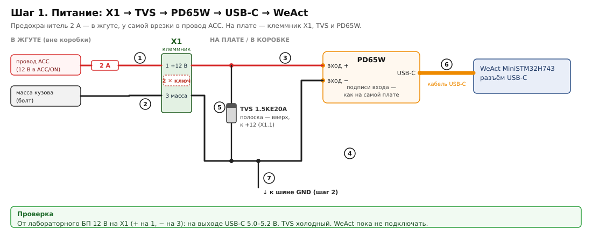
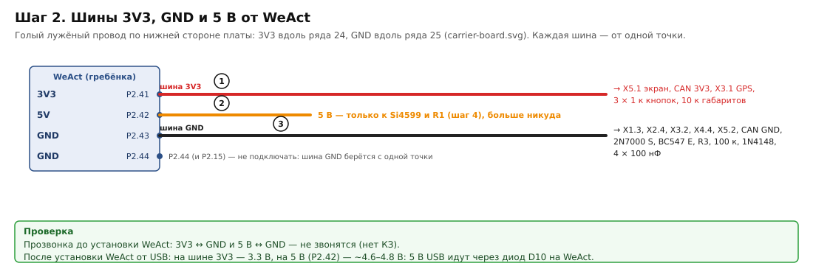
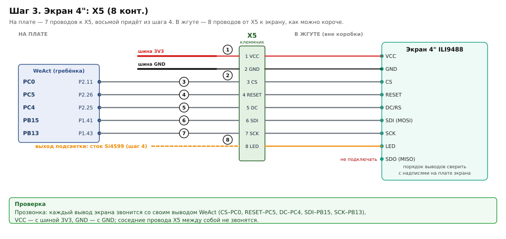
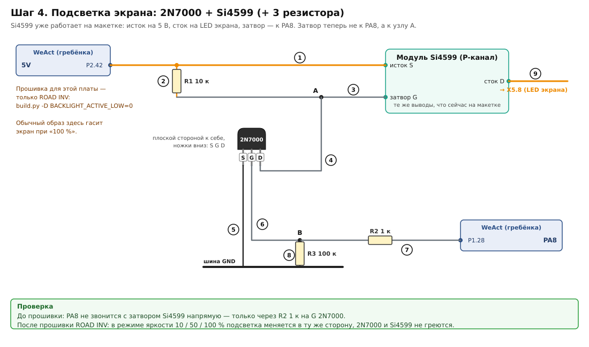
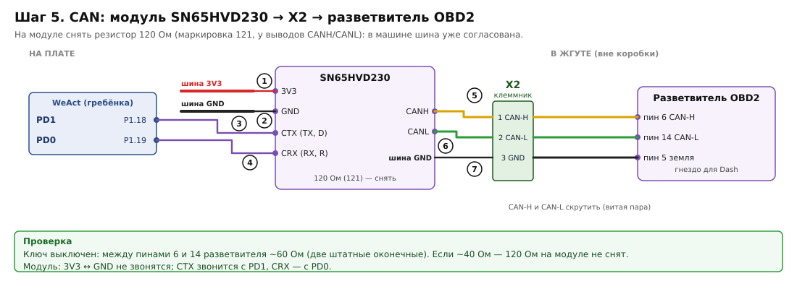
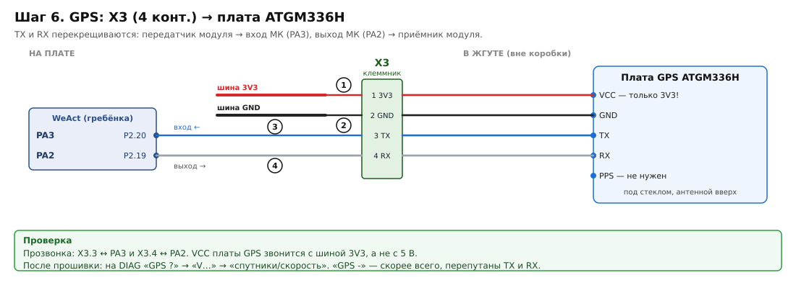
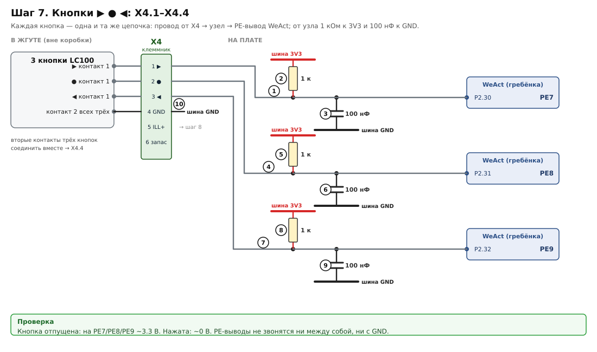
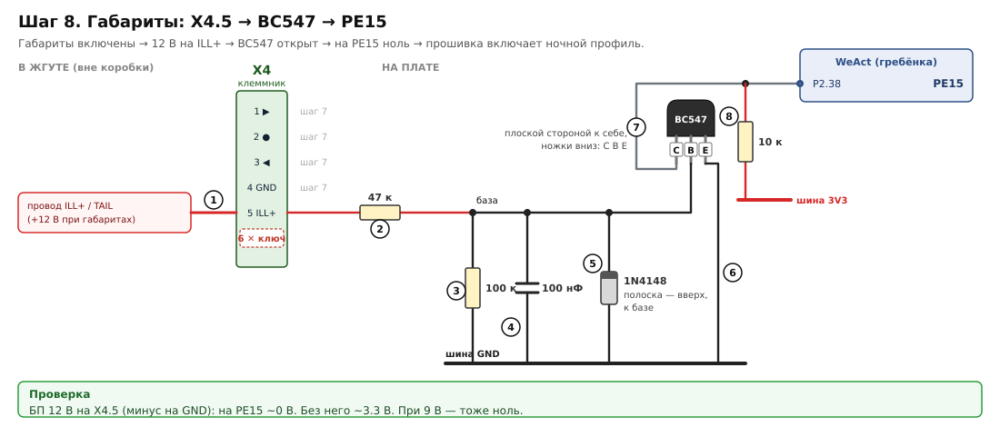

# Сборка платы-носителя по шагам: что куда паять

Каждый шаг — один узел. На картинке:

- каждая деталь со своими ногами, каждый провод под номером;
- под картинкой — те же номера таблицей «откуда → куда»;
- в конце шага — проверка мультиметром.

Порядок шагов не случайный: питание проверяется до того, как к нему что-то подключено.

Обозначения на картинках:

- **WeAct (гребёнка)** — вывод платы: сигнал (`PC0`) и номер на гребёнке (`P2.11`, распиновка — [carrier-board.md](carrier-board.md) §1). Подписи на самой WeAct сверить до пайки.
- **X1…X5** — клеммники на краю платы. Номера выводов совпадают с маркировкой проводов жгута ([build-hardware.md](build-hardware.md), «Маркировка жгута»). **✕ ключ** (X1.2, X2.3, X4.6) — штыря нет, провода нет (шаг 0).
- **шина 3V3 / шина GND** — голый лужёный провод по нижней стороне платы (шаг 2). «К шине GND» = припаять к этому проводу в любом месте.
- **Транзисторы** (2N7000, BC547) нарисованы как держишь в руке: плоской стороной к себе, ножки вниз.
- **Диоды** — полоска на корпусе там же, где на картинке.

Где что стоит на плате по отверстиям — [carrier-board.svg](carrier-board.svg), а в натуральную величину, чтобы положить на макетку, — [carrier-template.pdf](carrier-template.pdf). Печатать 100 %, сверить линейку 50 мм. Лист 2 — вид со стороны пайки, с шинами. Общая картинка всего сразу — [wiring-overview.svg](wiring-overview.svg).

**Прошивка для этой платы — `ROAD INV`** (`python tools/build.py -D BACKLIGHT_ACTIVE_LOW=0`): из-за драйвера подсветки на 2N7000 (шаг 4).

---

## Шаг 0. Гнёзда клеммников X1–X5 и ключи

Подробно — [carrier-board.md](carrier-board.md) §3. Коротко:

1. **Ключи.** Из гнёзд вынуть штырь 2 у X1, 3 у X2, 6 у X4. В вилках это же место заткнуть вынутым штырём и затянуть винт.
2. **Проволочки.** Гнёзда в макетку не вставляются: к каждому оставшемуся штырю (22 шт.) припаять внахлёст проволочку — со стороны его отверстия, под термоусадку 3 мм. Термоусадка 5.5 мм из заказа здесь не годится.
3. **На место.** Проволочки — в отверстия по таблице «Карта отверстий» (X1 — C30 / F30, X2 — P30 / Q30 / T30, X3 — W26–W30, X4 — W16–W22, X5 — W2–W12). Корпус — на ~4 мм над платой, паять снизу.
4. **Приклеить корпус** эпоксидкой или вспененным скотчем. Термоклей не годится.
5. **Проверка:** каждый штырь звонится со своим отверстием, соседние — нет. Каждая вилка входит только в своё гнездо; исключение — вилка X1 в гнезде X2 со сдвигом на одно место, это допустимо.

Отверстия не сверлить. Гнуть выводы (способ 2 в carrier-board.md §3) — только для стола.

## Шаг 1. Питание

| № | Откуда | Куда | Заметка |
|---|---|---|---|
| 1 | провод ACC в машине → предохранитель 2 А | X1.1 | жгут. Врезка — пайка + термоусадка, поверх тканевая изолента; предохранитель в держателе у самой врезки ([harness.md](harness.md), X1) |
| 2 | масса кузова (болт) | X1.3 | жгут |
| 3 | X1.1 | вход «+» PD65W | плата |
| 4 | X1.3 | вход «−» PD65W | плата |
| 5 | TVS 1.5KE20A | между X1.1 и X1.3 | **полоска — к X1.1 (+12)**. Лежит в рядах 26–27, колонки B–H — не в полосе под штекер USB-C |
| 6 | USB-C PD65W | USB-C WeAct | прямой кабель; PD65W — за нижним краем платы, штекер идёт по полосе I–N между X1 и X2 |
| 7 | X1.3 | шина GND | шаг 2 |

X1.2 — ключ, провода нет.

## Шаг 2. Шины

| № | Откуда | Куда | Заметка |
|---|---|---|---|
| 1 | 3V3 WeAct (P2.41) | шина 3V3 | одна точка |
| 2 | 5V WeAct (P2.42) | исток Si4599 и R1 | только для подсветки (шаг 4) |
| 3 | GND WeAct (P2.43) | шина GND | одна точка: P2.44 и P2.15 к шине не подключать |

На шине 5 В (P2.42) после установки WeAct — ~4.6–4.8 В, не 5.0: 5 В из USB-C идут на гребёнку через диод D10 на самой WeAct.

## Шаг 3. Экран (X5)

| № | Откуда | Куда |
|---|---|---|
| 1 | шина 3V3 | X5.1 |
| 2 | шина GND | X5.2 |
| 3 | PC0 (P2.11) | X5.3 |
| 4 | PC5 (P2.26) | X5.4 |
| 5 | PC4 (P2.25) | X5.5 |
| 6 | PB15 (P1.41) | X5.6 |
| 7 | PB13 (P1.43) | X5.7 |
| 8 | сток Si4599 (шаг 4) | X5.8 |

**В жгуте** X5.1…X5.8 идут на выводы экрана VCC, GND, CS, RESET, DC/RS, SDI, SCK, LED. SDO не подключается. Шлейф — как можно короче.

**До шага 4 — замер вывода LED экрана.** Подать на LED 3.3 В, потом 5 В, через мультиметр в режиме мА, записать ток. Единицы мА — LED только вход управления (транзистор подсветки стоит на самом модуле), и ключ на Si4599 может быть не нужен. Записать и сообщить, схему пока не менять ([build-hardware.md](build-hardware.md) §3, «Подсветка»).

## Шаг 4. Подсветка (2N7000 + Si4599)

Модуль Si4599 уже работает на макетке: его исток — на 5 В, сток — на LED экрана. Эти два провода остаются как есть. Меняется только затвор: он больше не идёт от PA8, а подключается к узлу A.

| № | Откуда | Куда | Заметка |
|---|---|---|---|
| 1 | 5V WeAct (P2.42) | исток S Si4599 | |
| 2 | R1 10 кОм | от 5 В — к узлу A | |
| 3 | узел A | затвор G Si4599 | раньше шёл от PA8 |
| 4 | сток D 2N7000 (правая нога) | узел A | |
| 5 | исток S 2N7000 (левая нога) | шина GND | |
| 6 | затвор G 2N7000 (средняя нога) | узел B | |
| 7 | R2 1 кОм | от узла B — к PA8 (P1.28) | |
| 8 | R3 100 кОм | от узла B — к шине GND | держит экран тёмным до старта прошивки. 100 к, не 10 к: с 10 к на затворе выходило 3.0 В — впритык к порогу 2N7000 |
| 9 | сток D Si4599 | X5.8 | |

## Шаг 5. CAN (X2)

| № | Откуда | Куда |
|---|---|---|
| 1 | шина 3V3 | 3V3 модуля CAN |
| 2 | шина GND | GND модуля |
| 3 | PD1 (P1.18) | CTX модуля |
| 4 | CRX модуля | PD0 (P1.19) |
| 5 | CANH модуля | X2.1 |
| 6 | CANL модуля | X2.2 |
| 7 | шина GND | X2.4 |

X2.3 — ключ, провода нет. На модуле снять резистор 120 Ом. Обычно это SMD с маркировкой `121` у выводов CANH/CANL.

**В жгуте:** X2.1 → пин 6, X2.2 → пин 14, X2.4 → пин 5 гнезда разветвителя OBD2. Провода 6 и 14 скрутить. От разветвителя до X2, вместе с хвостом разветвителя, — не больше ~30 см ([harness.md](harness.md), X2).

## Шаг 6. GPS (X3)

| № | Откуда | Куда |
|---|---|---|
| 1 | шина 3V3 | X3.1 |
| 2 | шина GND | X3.2 |
| 3 | X3.3 | 100 Ом → PA3 (P2.20) |
| 4 | PA2 (P2.19) | 100 Ом → X3.4 |

X3 стоит в колонке W, ряды 26–30, под X4: в ряду 30 он мешал бы штекеру USB-C. Резисторы 100 Ом — у X3, в зоне «GPS» (ряды 26–27, колонки R–U). Провод до GPS ~1.5 м выходит из коробки: резисторы ограничивают ток от статики и наводок, как 1 кОм у кнопок (шаг 7).

**В жгуте:** X3.1 → VCC (**только 3V3**), X3.2 → GND, X3.3 (белый) → TX платы GPS, X3.4 (синий) → RX платы GPS. PPS не нужен.

## Шаг 7. Кнопки (X4.1–X4.4)

| № | Откуда | Куда |
|---|---|---|
| 1 / 5 / 9 | X4.1 / X4.2 / X4.3 | узел кнопки (в зоне «кнопки», ряды 10–16) |
| 2 / 6 / 10 | 1 кОм от каждого узла | шина 3V3 |
| 3 / 7 / 11 | 100 нФ от каждого узла | шина GND |
| 4 / 8 / 12 | 1 кОм в линию от каждого узла | PE7 (P2.30) / PE8 (P2.31) / PE9 (P2.32) |
| 13 | X4.4 | шина GND |

Резистор в линию — между узлом и выводом WeAct, не между X4 и узлом: тогда 100 нФ и этот 1 кОм вместе фильтруют то, что приходит по 1.5-метровому проводу.

**В жгуте:** X4.1 / X4.2 / X4.3 → первый контакт кнопки ▶ / ● / ◀ (кнопки 8 мм, 1NO, в штатной заглушке). Вторые контакты всех трёх кнопок соединить вместе и → X4.4. Кольцо подсветки кнопок (12–24 В) через Dash не идёт: «+» к ILL+, «−» к ILL− штатной подсветки или к массе ([harness.md](harness.md), X4).

## Шаг 8. Габариты (X4.5)

| № | Откуда | Куда | Заметка |
|---|---|---|---|
| 1 | провод ILL+ / TAIL в машине, через 10 кОм у самой врезки ([harness.md](harness.md), X4) | X4.5 | жгут |
| 2 | 47 кОм | от X4.5 — к базе B BC547 | |
| 3 | 100 кОм | от базы — к шине GND | |
| 4 | 100 нФ | от базы — к шине GND | |
| 5 | 1N4148 | между базой и шиной GND | **полоска — к базе** |
| 6 | эмиттер E BC547 (правая нога) | шина GND | |
| 7 | коллектор C BC547 (левая нога) | PE15 (P2.38) | |
| 8 | 10 кОм | от коллектора / PE15 — к шине 3V3 | |

X4.6 — ключ, провода нет.

---

## После всех шагов

1. **Прозвонка** — [carrier-board.md](carrier-board.md) §6.
2. **WeAct в гнёзда:** USB-C — к ряду 30, разъём SWD — к верхнему краю платы. Вставить кабель USB-C: прямой штекер ни во что не упирается.
3. **Прошивка `ROAD INV`.** Проверки на столе — [bench-first-flash.md](../bench-first-flash.md) §5.
4. **SWD в коробке смотрит в стенку.** У верхнего края платы оставить ≥ 15 мм под колодку Dupont или заранее надеть на SWD шлейф и вывести его под крышку. В машине прошивать с открытой крышкой. Если плата питается от машины, от клона ST-LINK подключать только SWDIO, SWCLK и GND, не его 3.3 В ([carrier-board.md](carrier-board.md) §4).
