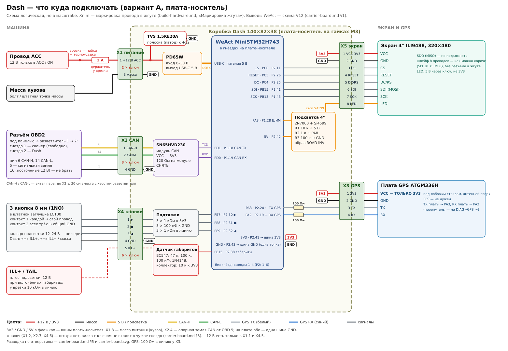

# Чистовая сборка: из макетки в устройство

**Машина:** Toyota Land Cruiser 100 (1998–2007) с мотором и ЭБУ от Holden Colorado RG 2.8 Duramax (E98) — данные читаем с ЭБУ Colorado, а кнопки, предохранители, подсветка и торпеда — тойотовские.

**Статус:** план и список покупок, 2026-10-11. Цены ориентировочные, перед заказом проверить. Новые функции (GPS, одометр, расход) — в [gps-odometer-fuel.md](gps-odometer-fuel.md) и [gps-performance-meter.md](gps-performance-meter.md).

## 1. Что не так с макетом

| Узел | Сейчас | Чем плохо |
|---|---|---|
| Соединения | Dupont-провода, макетная плата | В машине вибрация: дребезг контактов даёт ошибки SPI (`SPI …` на DIAG), сбросы, пропадание CAN |
| Питание | Не задокументировано, защиты от бортсети не подтверждены (аудит H01) | Броски при пуске, выбросы при сбросе нагрузки, переполюсовка |
| CAN | Модуль SN65HVD230: стойкость линий −4…+16 В, нет рейтинга по автомобильным импульсам ISO 7637 (аудит H02; ESD на линиях шины по даташиту TI — 16 кВ HBM, ревью C9) | Для постоянной установки слабовато; проверить, что снят 120 Ом |
| Подсветка | P-канал Si4599 с затвором прямо от 3.3 В: в «выключено» Vgs ≈ −1.3…−1.5 В (исток за диодом D10 на 4.6–4.8 В, §5; аудит H03 считал от 5.0 В: −1.7 В) | Может не закрываться до конца, греться, светить при 0 % |
| Корпус | Нет | Пыль, замыкания; PLA на солнце поплывёт |

## 2. Выбранная схема (вариант A) и что потом

Собираем **один** вариант — **A**, плата-носитель на макетке с модулями. Всё ниже до §6c относится к нему:

| Узел | Выбрано | Состояние |
|---|---|---|
| Питание | ACC (врезка в провод) → предохранитель 2 А в линию → TVS **1.5KE20A** → **PD65W** (вход 8–30 В) → USB-C → WeAct | PD65W куплен. **Стенд / эксперимент:** стойкость к автомобильным импульсам не доказана, для постоянной установки не утверждено (§3, ревью C5-HW-03). Резисторы CC 5.1 кОм на WeAct есть (R13 / R14, схема V12); то, что модуль без запроса быстрой зарядки отдаёт 5 В, — **допущение, замерить** (§5) |
| CAN | нынешний **SN65HVD230** без 120 Ом | есть |
| GPS | **готовая плата ATGM336H с антенной и выводами** (VCC / GND / TX / RX / PPS, шаг 2.54), питание от **3V3** WeAct — без пайки модуля 10×10 | AliExpress (на LCSC готовых плат нет) |
| Подсветка 4" | P-FET Si4599 (есть) + драйвер затвора на **2N7000** (R1 10 к / R2 1 к / R3 100 к). Инвертирует логику: нужен образ `-D BACKLIGHT_ACTIVE_LOW=0` (§3). До пайки — замер вывода LED экрана (§3) | LCSC + дома |
| Кнопки, день/ночь | 3 кнопки 8 мм (1NO, кольцо подсветки 12–24 В) в штатной заглушке LC100 на **PE7 / PE8 / PE9**, габариты через **BC547** на **PE15** | заказаны (§6c) |
| Память пробега | SPI NOR на самой WeAct (SPI1, CS = PD6) | на плате |
| Соединения | макетка 7×9, клеммники 3.81 парами (гнездо KF2EDGV + вилка KF2EDGK): X1 — 3 конт., X2 и X3 — 4, X4 — 6, X5 — 8; гнёзда на плате — на коротких проводах, у X1 / X2 / X4 ключ ([carrier-board.md](carrier-board.md) §3). Если надо — и в жгуте; Superseal — потом | LCSC + AliExpress (§8) |

Цена — §6. Дорогой вариант (Pololu D36V28F5, TJA1051, u-blox M10) — **отдельно, в §6a**, со своей схемой и списком; детали двух вариантов не смешивать.

**B. Потом: своя плата-носитель (JLCPCB).** WeAct на гребёнке, на плате защита питания, понижающий преобразователь, автомобильный CAN-трансивер, драйвер подсветки, разъёмы. Нарисую, когда A отработает в машине и станет ясно, что оставлять (§7).

## 3. Схема узлов (вариант A)

**Что куда паять — по шагам, каждая деталь и каждый провод:** [assembly.md](assembly.md). Общая схема «что куда» — машина → коробка → экран и GPS, с номерами проводов жгута и выводами WeAct: [wiring-overview.svg](wiring-overview.svg).



```
 ACC +12 В ─ врезка в ACC ── предохранитель 2 А ─┬─ TVS 1.5KE20A ─ GND   (полоска на диоде — к +)
 (замок зажигания)                               └─► PD65W вход (8–30 В) ─ USB-C ─► WeAct
                                                                                      │
   WeAct V+ (5 В от USB) ─► подсветка 4" через P-FET Si4599 (драйвер — ниже)
   WeAct 3V3 ─► VCC дисплея 4", VCC SN65HVD230, VCC платы GPS ATGM336H (от 3V3),
               подтяжки кнопок и датчика габаритов
 OBD-разветвитель ─ пин 6/14, витая пара ─► SN65HVD230 CANH/CANL (без 120 Ом!)
                    пин 5 ─► общая земля (одна точка)
```

### Питание
- **ACC — врезкой прямо в провод ACC**, без add-a-circuit (решение владельца, 2026-10-20).
  - Провод найти мультиметром: 12 В только в положениях ACC / ON, 0 В при вынутом ключе.
  - Соединение — пайка в «окно» без перерезания штатного провода, два слоя изоленты, поверх — тканевая; термоусадка — на новом проводе и у держателя. Не «скотчлок»: он от вибрации со временем теряет контакт. Как именно — [harness.md](harness.md), X1.
  - Не пин 16 OBD и не постоянный +12 В: они не отключаются и посадят АКБ ([vehicle-install.md](../vehicle-install.md) §1).
- **Предохранитель 2 А** в держателе в линию, **у самой врезки**: провод от врезки до него защищает только штатный предохранитель цепи ACC, рассчитанный на ток побольше. Его задача — **проводка при КЗ**. Это не защита от выбросов (перегорает за миллисекунды, выброс короче) и не доказанная защита от переполюсовки: тогда TVS открывается в прямом направлении, и, скорее всего, предохранитель сгорит, но TVS может не выдержать первым. Согласование предохранителя и TVS (ток КЗ, I²t, энергия, нагрев) не считалось (ревью C5-HW-03).
- **TVS 1.5KE20A** (Littelfuse, [LCSC C1976464](https://www.lcsc.com/product-detail/C1976464.html)): рабочее напряжение 17.1 В, пробой от 19 В, ограничение **не выше 27.7 В при 54 А и импульсе 10/1000 мкс**. Это ниже 30 В — верхнего предела входа PD65W, но только в этой точке даташита: при другой форме и токе, с индуктивностью выводов и разводкой выброс может быть выше. 1500 Вт — тоже для 10/1000 мкс, а не для постоянного напряжения и не для сброса нагрузки длиной в десятки–сотни миллисекунд. Раньше здесь стоял 1.5KE22A, но у него ограничение 30.6 В — выше предела модуля ещё до учёта проводов и разброса (ревью C4-HW-03).
  - От 19 В TVS начинает проводить. При долгих 19 В и выше (прикуривание от 24 В, отказ регулятора генератора) он проводит постоянно, и **не гарантировано**, что предохранитель сгорит раньше, чем перегреется TVS (в первой версии здесь было «сгорит — так задумано»; это не подтверждено расчётом).
  - **Не известно:** настоящий предел PD65W. «8–30 В» — рабочий диапазон из листинга, абсолютного максимума у модуля нет. Когда придёт: прочитать маркировку контроллера и напряжение входных конденсаторов (§5). Конденсаторы на 25 В — модуль на бортсеть не ставить. Конденсаторы на 35 В и выше — необходимое условие, но **не доказательство**: стойкость собранной платы к перенапряжению, переполюсовке и импульсам это не показывает.
  - **Не проверено и дома не проверяется:** стойкость к автомобильным импульсам (ISO 7637-2 / ISO 16750-2: сброс нагрузки, отрицательные импульсы). При отрицательном выбросе TVS открывается в прямом направлении, на модуле около −1…−3 В. Нужна защита с подтверждёнными характеристиками — это вариант §6a (Pololu: вход до 50 В, переполюсовка до 40 В).
- **Итог по питанию A:** годится для стола и опытной езды. Для постоянной установки — одно из двух: (1) определить точную плату PD65W и её контроллер, снять выход 5 В при 9 / 12 / 14.4 / 16 В, при пуске и прокрутке стартером, посмотреть выбросы на входе осциллографом; или (2) взять модуль питания с документированной стойкостью к автомобильным импульсам и переполюсовке (§6a).
- **Масса питания (X1.3) — к болту на кузове**, кольцевой клеммой (§8), не к OBD 4/5. OBD 5 — только опорная земля CAN (X2.4), OBD 4 не подключается. На плате обе — одна шина GND.
  - **Оговорка (ревью C9).** Так X1.3 + X2.4 становятся параллельной перемычкой из 22 AWG между кузовом и сигнальной массой ECM. Пока штатная масса двигатель–кузов цела, тока по ней почти нет. Если эта масса окислится или отвалится, при пуске часть тока стартера пойдёт этим путём и сожжёт провод в панели. Защита — **47 Ом 0.25 Вт последовательно в X2.4** у коробки (из набора): опоре CAN нужны микроамперы, а при аварии резистор перегорит раньше провода. Не обязательно — решить при сборке; если ставить, отметить в жгуте.

### CAN
- **SN65HVD230** (есть): VCC — 3V3 с WeAct, TXD → PD1, RXD → PD0. **Снять резистор 120 Ом**, если стоит на модуле, и проверить 60 Ом на OBD при выключенном зажигании.
- Линии выдерживают −4…+16 В, рейтинга по автомобильным импульсам (ISO 7637) нет (аудит H02): для постоянной установки слабовато. Статика тут не главное: по даташиту TI линии шины держат 16 кВ HBM (ревью C9), слабое место — узкий диапазон напряжений против ±58 В у TJA1051. Замена — TJA1051T/3 из §6a, отдельным шагом, когда A заработает.
- **Разветвитель OBD (1 штекер → 2 гнезда):** провод от гнезда, штатный порт остаётся свободным для сканера. CANH/CANL — **витая пара**; отвод от разветвителя до X2 вместе с хвостом самого разветвителя — **не длиннее ~30 см** ([vehicle-install.md](../vehicle-install.md): отводы шины до ~30 см).

### Подсветка: драйвер затвора
Затвор P-канала тянется к 5 В резистором, а открывается N-канальным транзистором от PA8:

```
 5 В ──┬──────────────► исток P-FET (Si4599, модуль)
       R1 10 кОм
       ├──────────────► затвор P-FET
       │
     сток
   N-FET 2N7000 (TO-92)
     исток ── GND
     затвор ── R2 1 кОм ── PA8
     затвор ── R3 100 кОм ── GND  (на сбросе PA8 висит → подсветка выкл.)
```

- **R3 — 100 кОм, не 10.** С 10 кОм делитель R2 / R3 давал на затворе 3.3 × 10 / 11 = 3.0 В — ровно максимум Vgs(th) у 2N7000 JSCJ (3.0 В при 1 мА). Это тот же запас, из-за которого 2N7000 не взяли для PE15 (§6c). Со 100 кОм — 3.3 × 100 / 101 = 3.27 В, а 2N7000 нужно тянуть всего ~0.5 мА через R1. R3 только держит затвор закрытым, пока PA8 висит: ток утечки затвора — наноамперы, 100 кОм хватает. Резистор — из набора.
- **До пайки драйвера — проверить вывод LED экрана (стол).** У соседних 4" SPI-модулей LCDWIKI подсветку включает транзистор на самом модуле, а LED описан как управляющий вход («high level lighting», без управления — на 3.3 В). Подать на LED 3.3 В, потом 5 В, через мультиметр в режиме мА, и записать ток. Единицы мА — LED только вход управления, и ключ на Si4599 может быть не нужен. Это **записать и сообщить**, схему пока не менять. Десятки мА и больше — светодиоды подключены напрямую, ключ нужен, как нарисовано.

- **Логика инвертируется — это переход, а не правка (ревью C5-HW-04).** Нынешняя прошивка собрана под прямое управление (`BACKLIGHT_ACTIVE_LOW 1` по умолчанию): на этой плате её «100 %» = PA8 в 0 = 2N7000 закрыт = **подсветка выключена**. Для новой платы собрать и шить только `python tools/build.py -D BACKLIGHT_ACTIVE_LOW=0` (папка `build-backlight_active_low_0/`; любое значение кроме 0 и 1 не соберётся, а в режиме яркости маленький экран пишет «BL INVERT»); на старую проводку — только образ по умолчанию.
- Пока ШИМ не запущен (сброс, загрузка до конца `AppMain_Init`), уровень PA8 задаёт не наша прошивка; R3 держит 2N7000 закрытым, поэтому ожидается тёмный экран до старта ШИМ. Проверить на столе.
- ШИМ подсветки около 0.93 кГц (TIM1 тактируется 224 МГц, делитель 240, период 1000). С R1 10 кОм фронт закрытия P-FET ~10–15 мкс при периоде ~1 мс — не влияет.
- До пайки прозвонить, какие ноги модуля Si4599 куда выведены; после — на столе: яркость и Vgs P-FET при 0 / 50 / 100 %, уровень при сбросе и загрузке, нагрев.

### GPS
- **Выбрана готовая плата ATGM336H с антенной и выводами** (владелец не хочет паять модуль 10×10). **Питать от 3V3 WeAct:** это подходит и плате без стабилизатора (самому модулю нужно 2.7–3.6 В), и плате со стабилизатором. 5 В не подавать, пока не видно, что на плате есть стабилизатор. TX платы → **PA3**, RX ← **PA2** (USART2), в каждой линии **100 Ом** у X3. Провод до GPS ~1.5 м выходит из коробки — по той же причине, что 1 кОм у кнопок (§6c, аудит 2026-10-22): резистор ограничивает ток, если по проводу придёт статика или наводка. На 115200 бод не влияет: 100 Ом × ~150 пФ провода — 15 нс при бите 8.7 мкс. Резистор — из набора. Ставить под лобовое или на торпеду, антенной вверх. Лучше вариант «6N» (GPS + BeiDou + Galileo + ГЛОНАСС).
- **Питание GPS тоже уходит из коробки на 1.5 м (ревью C9).** КЗ VCC на массу в проводе (защемило у стойки или под обшивкой) сажает шину 3V3 самой WeAct: гаснет вся плата, не только GPS. Резистор в VCC не ставить: модуль при поиске спутников берёт десятки мА, а плате без стабилизатора нужно не меньше 2.7 В. Поэтому: (1) провод вести без мест, где его может защемить, у стойки — в гофре или под тканевой изолентой; (2) по желанию — самовосстанавливающийся предохранитель (PTC) на ~0.1 А удержания последовательно в X3.1 у коробки, если найдётся. Тогда КЗ даёт один сброс платы, а не постоянно погасшую плату. Ток модуля замерить до выбора.
- Голый модуль ATGM336H-6N-74 (LCSC C5804601) с пассивной патч-антенной — запасной путь для тех, кто паяет 10×10 (подключение — §6b). Ему **только 3V3**, 5 В нельзя.

### Кнопки и датчик габаритов
- **PE7** = ▶, **PE8** = ●, **PE9** = ◀, **PE15** = габариты (§6c).
- **Не PD3–PD6**, как в первой версии (ревью C4-HW-01). На WeAct MiniSTM32H743 **PD6 — CS SPI-флешки** (она нужна под пробег), **PD4 — датчик карты microSD**, **PD3 — линия D5 порта камеры**. Источники: описания платы в [Zephyr](https://github.com/zephyrproject-rtos/zephyr/blob/main/boards/weact/mini_stm32h743/mini_stm32h743.dts) (`cs-gpios = <&gpiod 6 …>`, `cd-gpios = <&gpiod 4 …>`) и [MicroPython](https://github.com/micropython/micropython/tree/master/ports/stm32/boards/WEACTSTUDIO_MINI_STM32H743) (`MICROPY_HW_SPIFLASH_CS (pin_D6)`, `MICROPY_HW_SDCARD_DETECT_PIN (pin_D4)`).
- PE7 / PE8 / PE9 / PE15 не заняты ни прошивкой (`Dash.ioc`; экран статуса — PE10–PE14), ни платой ни в одном из этих описаний. Карта пинов — [wiring.md](../wiring.md). **Перед пайкой** сверить со схемой WeAct (папка `Hardware/` в [WeActStudio/MiniSTM32H7xx](https://github.com/WeActStudio/MiniSTM32H7xx)) и прозвонить: пин выведен на гребёнку (у платы две гребёнки 2×22) и ни к чему на плате не подключён.
- Память пробега — на SPI NOR самой WeAct; FRAM не нужен.

### Разъёмы и жгут
- Плата-носитель: **гнёзда 2.54 под WeAct** (плата снимается) и **клеммники 3.81 парами** под модули и дисплей: 3 конт. — питание (X1), 4 — CAN (X2) и GPS (X3), 6 — кнопки + габариты (X4), 8 — дисплей (X5); 2-контактные — запас. На плате гнездо KF2EDGV в отверстия не вставляется: к его штырям припаяны короткие проволочки под термоусадкой 3 мм, они входят в отверстия, а корпус приклеен к плате ([carrier-board.md](carrier-board.md) §3). У X1, X2 и X4 одно место — **ключ**: чужая вилка в гнездо не войдёт (там же, «Ключи»). Как разъём «провод–провод» в жгуте: гнездо не паять на плату, а напаять провода на его штыри под термоусадку. Держатся трением — в машине прихватить стяжкой; вариант с фиксирующими винтами — KF2EDGVM + KF2EDGKM. Разъёмы Superseal (§8) — потом, если понадобятся.
- Дисплей 4": шлейф 8 проводов (SPI 18.75 МГц) — как можно короче, без разъёма в жгуте.
- Провод: **22 AWG силиконовый** (куплен, 5 цветов × 5 м) во всём жгуте — и 12 В с массой, и сигналы; для CAN две жилы скрутить в витую пару. Для 12 В его хватает: ток платы — доли ампера, а предохранитель 2 А у врезки сгорит раньше, чем нагреется провод 22 AWG.
- Жгут обмотать тканевой изолентой (есть), чтобы не дребезжал. Термоусадка на все пайки.
- Каждый жгут закрепить у разъёма (стяжка к корпусу), чтобы тянуло не за пайку.

Раскладка платы-носителя по отверстиям, распиновка гребёнок WeAct (схема V12) и полный список проводов — [carrier-board.md](carrier-board.md) и [carrier-board.svg](carrier-board.svg).

### Маркировка жгута

Каждый разъём — номер X, каждый провод подписан с **обоих концов** как `X<разъём>.<контакт>` (например `X2.1`). Цвета — подсказка, но главное — надпись: с ней жгут собирается обратно без прозвонки. Эту же таблицу распечатать и наклеить на крышку коробки изнутри.

| Разъём | Конт. | Сигнал | Куда на плате | Цвет провода |
|---|---|---|---|---|
| **X1** питание (3) | 1 | +12 В ACC после предохранителя 2 А | вход PD65W | красный |
| | 2 | **ключ** — штыря нет, провода нет | — | — |
| | 3 | масса | GND | чёрный |
| **X2** CAN (4) | 1 | CAN-H (OBD 6) | SN65HVD230 CANH | жёлтый ┐ витая |
| | 2 | CAN-L (OBD 14) | SN65HVD230 CANL | зелёный ┘ пара |
| | 3 | **ключ** | — | — |
| | 4 | signal GND (OBD 5) | GND | чёрный |
| **X3** GPS (4) | 1 | 3V3 | 3V3 WeAct | красный |
| | 2 | масса | GND | чёрный |
| | 3 | TX платы GPS | 100 Ом → PA3 (USART2 RX) | белый |
| | 4 | RX платы GPS | 100 Ом ← PA2 (USART2 TX) | синий |
| **X4** кнопки (6) | 1 | ▶ | PE7 (узел: 1 кОм к 3V3 и 100 нФ к GND; к выводу — через 1 кОм в линию) | любой + метка |
| | 2 | ● | PE8 | любой + метка |
| | 3 | ◀ | PE9 | любой + метка |
| | 4 | общий провод кнопок | GND | чёрный |
| | 5 | ILL+ (габариты, 12 В) | датчик BC547 → PE15 | красный + метка |
| | 6 | **ключ** | — | — |
| **X5** дисплей (8) | 1 | VCC | 3V3 | красный |
| | 2 | GND | GND | чёрный |
| | 3 | CS | PC0 | любой + метка |
| | 4 | RESET | PC5 | любой + метка |
| | 5 | DC/RS | PC4 | любой + метка |
| | 6 | SDI (MOSI) | PB15 | любой + метка |
| | 7 | SCK | PB13 | любой + метка |
| | 8 | LED (подсветка) | сток P-FET Si4599 (5 В через ключ) | любой + метка |

SDO дисплея не подключается. Два красных в одном разъёме (X3, X5) — оба 3V3; +12 В есть только в X1.1 и X4.5 — их метки делать особенно заметными. **Ключи** (X1.2, X2.3, X4.6): в гнезде этот штырь вынут, в вилке это место заткнуто — вилки X1, X2, X4 не входят в чужие гнёзда ([carrier-board.md](carrier-board.md) §3, «Ключи»). Единственное, что остаётся, — вилка X1 в гнезде X2 со сдвигом на одно место: +12 В тогда попадает на CANL трансивера. Постоянное напряжение (до 14.8 В при зарядке) он выдержит, предел +16 В. Но TVS стоит у гнезда X1, а не на этом пути: выбросы бортсети попадут на CANL без ограничения, и их трансивер может не пережить (ревью C9). Поэтому вилку X1 вставлять только по метке, а после установки проверить мультиметром: на X2.1 / X2.2 нет 12 В.

## 4. Корпус и установка

- **Материал:** ASA, ABS или PETG. **Не PLA:** он размягчается около 55–60 °C, а на торпеде под солнцем бывает 70–90 °C и выше.
- **Электроника:** ABS-коробка **140×82×38** (куплена). Ставить внутри торпеды или под ней. Плата-носитель — на одной гайке M3 ([carrier-board.md](carrier-board.md) §7), модули — на двустороннем скотче.
- **Дисплей:** печатная рамка под модуль 4" (размеры модуля снять штангенциркулем) + **матовая антибликовая плёнка** — помогает на солнце (аудит U05).
- **Где ставить экран:** не в зоне раскрытия подушки безопасности, не закрывая обзор, так, чтобы читался без отрыва взгляда надолго.
- **GPS** — под стеклом или на торпеде с видом на небо. Если стекло атермальное (с металлизацией), сигнал будет хуже, тогда — внешняя антенна.

## 5. Порядок сборки и проверки

Порядок пайки по шагам, с картинками и проверкой после каждого шага, — [assembly.md](assembly.md). Здесь только то, что проверить и когда. Прозвонка платы идёт **до** первого включения WeAct на ней (ревью C9: раньше она стояла после шагов, где плата уже под питанием).

1. **Питание отдельно, без WeAct:** PD65W + TVS + предохранитель от лабораторного блока. Записать маркировку контроллера модуля и напряжение его входных конденсаторов (§3). На входе 9 / 12 / 14.4 / 16 В — на USB-выходе 5.0–5.2 В (USB-тестер или разрезанный кабель).
2. **Плата-носитель собрана, WeAct не вставлена:** прозвонить всё ([carrier-board.md](carrier-board.md) §6). Нет КЗ 5 В и 3V3 на землю. VCC GPS — на 3V3, а не на 5 В. PE7 / PE8 / PE9 / PE15 не звонятся ни на соседние пины, ни на землю.
3. **WeAct от модуля, без дисплея:** на `V+` / P2.42 ожидается **~4.6–4.8 В**, не 5.0: 5 В из USB-C идут на гребёнку через диод Шоттки D10 (B5819WS) на самой WeAct, он съедает 0.2–0.4 В. На выходе PD65W до кабеля — 5.0–5.2 В (шаг 1). Резисторы CC 5.1 кОм на USB-C WeAct есть (R13 / R14 по схеме V12), поэтому 0 В — это кабель или модуль, а не «модуль не видит потребителя». Пока это не замерено, «PD65W держит 5 В» — допущение.
4. **Драйвер подсветки:** до пайки — замер вывода LED экрана при 3.3 и 5 В (§3, «Подсветка»), результат записать. Потом прошить образ `-D BACKLIGHT_ACTIVE_LOW=0` (не образ по умолчанию, §3) — в режиме яркости на маленьком экране под «BRIGHTNESS» должно быть «BL INVERT». Затем яркость и Vgs при 0 / 50 / 100 %, экран при сбросе и загрузке, нагрев.
4a. **Датчик габаритов:** при 9 / 12 / 14.4 В на ILL+ (через резистор 10 кОм, как у врезки — [harness.md](harness.md), X4) на PE15 ноль, без него — единица; затем стенд «плата без питания, габариты вкл.» (§6c).
5. **В машине, ключ на ON, мотор заглушён:** 60 Ом на CAN при выключенном зажигании, затем DIAG: `LOST`, `BAD`, `TXF` = 0, `ECM OK` на маленьком экране.
6. **Пуск двигателя:** ACC у Toyota на время прокрутки стартером обычно пропадает, поэтому плата **перезапускается при каждом пуске** и встаёт сама. `LAST RESET` — `POWER ON` или `BROWN-OUT`, это не авария; `WATCHDOG`, `HARDFAULT` и другие — авария. Если не перезапускается — тоже нормально: значит, ACC в положении START не отключается.
7. **Тепло:** час на солнце с включённым экраном — корпус не поплыл, ничего не перегрелось.

## 6. Стоимость варианта A

Что уже есть, не покупается: PD65W и кабель USB-C, SN65HVD230, модуль Si4599, резисторы, 100 нФ, термоусадка, stripboard под GPS.

| Часть | Где | ≈ Цена |
|---|---|---|
| Электроника и крепёж: 2N7000, TVS 1.5KE20A, клеммники 3.81 парами (2/3/4/6/8 конт.), гнёзда под WeAct, стойки и гайки M3 (BC547 для габаритов — из того же заказа, лот CubeCrossPro) | LCSC | US$17.3 |
| Плата GPS ATGM336H с антенной и выводами | AliExpress | US$3–5 |
| Материалы: макетка 7×9, провод 22 AWG, разветвитель OBD, предохранители 2 А и держатель в линию, коробка, винты M3 | AliExpress / Jaycar, §8 | ~AU$15 |
| 3 кнопки 8 мм, 1NO, с кольцом подсветки | AliExpress, §6c | заказаны |
| Разъёмы TE Superseal 1.5 в жгут — **потом, пока не берём** (номера — §8) | LCSC | ~US$16 |

**Обязательное ядро** (электроника + материалы) — около US$25. Кнопки и разъёмы — сверху.

Отклонено: зарядка в прикуриватель (розетка может не отключаться с зажиганием, провод на виду), LM2596 с AliExpress (не автомобильный, без защиты), голый модуль ATGM336H 10×10 (паять мелко; выбрана готовая плата с антенной, §3 «GPS»; модуль — запасной путь, §6b).

Компромиссы честно:
- ATGM336H чувствительнее к плохому небу, только NMEA, но скорость в RMC доплеровская — для одометра и плитки скорости нормально.
- PD65W — не автомобильный модуль, его предел неизвестен; TVS и предохранитель его прикрывают, но стойкость не доказана. Поэтому питание A — для стола и опытной езды, не для постоянной установки (§3, «Итог по питанию A»).
- SN65HVD230 вместо автомобильного трансивера — работает, пока шина живёт без выбросов. TJA1051T/3-модуль за $1–2 можно добавить, если хочется запаса.
- SPI NOR вместо FRAM — больше прошивки (журнал, стирание по 4 КБ), но бесплатно, и по износу запас на десятилетия.

## 6b. Заказ на LCSC (проверено по API LCSC 2026-10-11)

Питание уже куплено: модуль **PD65W** (вход 8–30 В) и USB-кабель на WeAct. Что модуль без запроса быстрой зарядки отдаёт 5 В (WeAct её не просит) — **по листингу, не замерено**: §5, шаги 1 и 3.

| # | Что | LCSC | Кол-во (мин.) | Цена, $ | Зачем |
|---|---|---|---|---|---|
| 1 | ~~GNSS ATGM336H-6N-74~~ — **убран из заказа**: вместо голого модуля готовая плата с AliExpress (§3 «GPS») | [C5804601](https://www.lcsc.com/product-detail/C5804601.html) | — | — | Только если паять 10×10 |
| 2 | Керамическая патч-антенна 25×25, 1575 МГц, вывод в отверстие (BWGNSCNX25-25W4) | [C784398](https://www.lcsc.com/product-detail/C784398.html) | 1 | 0.77 | Антенна к модулю. **Осталось 26 шт.** |
| 4 | **2N7000** TO-92 | [C9114](https://www.lcsc.com/product-detail/C9114.html) | 10 | 0.44 | Драйвер затвора подсветки |
| 5 | Резистор 10 кОм 0.25 Вт выводной — **у владельца есть дома, не заказывать** | [C57436](https://www.lcsc.com/product-detail/C57436.html) | 50 | 0.71 | Подтяжки, драйвер |
| 6 | Резистор 1 кОм 0.25 Вт выводной — **есть дома** | [C57435](https://www.lcsc.com/product-detail/C57435.html) | 50 | 0.71 | Затвор 2N7000, подтяжка кнопок |
| 7 | TVS **1.5KE20A** (Littelfuse), 17.1 В рабочее, ограничение 27.7 В | [C1976464](https://www.lcsc.com/product-detail/C1976464.html) | 5 | 0.80 | На вход PD-модуля (вход до 30 В). Вместо 1.5KE22A: у того 30.6 В (ревью C4-HW-03) |
| 8 | Клеммники 3.81 мм парами: гнездо KF2EDGV + вилка с винтами KF2EDGK, 2 / 3 / 4 / 6 / 8 конт. | 2P [C441332](https://www.lcsc.com/product-detail/C441332.html) + [C440858](https://www.lcsc.com/product-detail/C440858.html), 3P [C441333](https://www.lcsc.com/product-detail/C441333.html) + [C440859](https://www.lcsc.com/product-detail/C440859.html), 4P [C441334](https://www.lcsc.com/product-detail/C441334.html) + [C440860](https://www.lcsc.com/product-detail/C440860.html), 6P [C441336](https://www.lcsc.com/product-detail/C441336.html) + [C440862](https://www.lcsc.com/product-detail/C440862.html), 8P [C441338](https://www.lcsc.com/product-detail/C441338.html) + [C440864](https://www.lcsc.com/product-detail/C440864.html) | 2P 20 + 10, 3P 10 + 10, 4P / 6P / 8P по 5 + 5 | 3P 3.15, 4P 1.95, 6P 2.79, 8P 3.75 (за строку) | Что где стоит: X1 — 3P, X2 и X3 — 4P, X4 — 6P, X5 — 8P; 2P — запас и проба гибки. Шаг 3.81 под макетку 2.54 — ошибка выбора (нужен был 5.08), ставятся на проволочках ([carrier-board.md](carrier-board.md) §3) |
| 9 | — вилки вошли в строку 8 | — | — | — | — |
| 10 | Гнездо 2.54 мм 1×40 (под WeAct, отламывается по длине) | [C9811](https://www.lcsc.com/product-detail/C9811.html) | 2 | 1.29 | WeAct снимается с платы |
| 11 | Конденсатор 100 нФ выводной — **есть дома** | [C168753](https://www.lcsc.com/product-detail/C168753.html) | 10 | 0.47 | Развязка GPS, антидребезг кнопок |
| 12 | Электролит 10 мкФ 16 В | [C43798](https://www.lcsc.com/product-detail/C43798.html) | 20 | 0.55 | Развязка GPS |

**Итого без того, что есть дома, ~$8.86** (позиции 1, 2, 4, 7, 8, 9, 10, 12) плюс доставка — это расчёт до заказа, клеммники в нём только 4-контактные. Ушёл заказ общий с CubeCrossPro, иначе ниже порога сбора $15: US$39.39 за 29 позиций, пришло всё (2026-10-23).

Не на LCSC — см. чек-лист §8.

### Подключение голого модуля GPS (ATGM336H-6N) — запасной путь

Модуль 10×10 мм с контактами по краям. На макетку: приклеить и развести тонким проводом (МГТФ / провод для монтажа накруткой) к соседним отверстиям — нужно 10 выводов из 18.

| Вывод модуля | Куда |
|---|---|
| 1, 10, 12 `GND` | GND |
| 8 `VCC` | **только 3V3** WeAct (не 5 В!) + 100 нФ и 10 мкФ рядом с выводом |
| 6 `VBAT` | на `VCC` (без батарейки, см. [gps-performance-meter.md](gps-performance-meter.md) §7) |
| 5 `ON/OFF` | на `VCC` (активный низкий = выключение) |
| 9 `nRESET` | 10 кОм на `VCC` |
| 2 `TXD0` | **PA3** (USART2 RX) |
| 3 `RXD0` | **PA2** (USART2 TX) |
| 11 `RF_IN` | вывод антенны, **как можно короче** |
| 14 `VCC_RF` | не подключать (антенна пассивная) |

- Под антенной — земля: кусок медной фольги или скотча на плате под патчем, соединить с GND. Чем больше площадка (хотя бы 50×50 мм), тем лучше приём.
- Плату с модулем и антенной — под лобовое или на торпеду, антенной в небо; к основной плате 4 провода (3V3, GND, TX, RX) через клеммник.
- Если пайка 10×10 мм пугает: готовая плата ATGM336H с антенной на AliExpress стоит те же ~$3–4.

### Питание с купленным модулем

Схема и выбор TVS — §3 «Питание», замеры перед подключением WeAct — §5, шаги 1 и 3.

### Драйвер подсветки на этих номиналах

R1 (затвор P-FET → 5 В) = 10 кОм, R2 (PA8 → затвор 2N7000) = 1 кОм, R3 (затвор 2N7000 → GND) = **100 кОм** (было 10 кОм: на затворе выходило 3.0 В — впритык к Vgs(th), §3). С R1 10 кОм фронт закрытия P-FET ~10–15 мкс при периоде ~1 мс — ок. Прошивка — только образ `-D BACKLIGHT_ACTIVE_LOW=0` (§3).

## 6c. Управление: кнопки Toyota и день/ночь

Экран стоит под панелью, нажимать что-то рядом с ним неудобно. Поэтому кнопки отдельные, в стороне от экрана — **в штатные заглушки LC100**.

### Кнопки

**Кнопки 8 мм, 1NO, без фиксации, с кольцом подсветки на 12–24 В** (заказаны). Ставятся в штатную заглушку LC100: три отверстия Ø8 в ряд, центры через 12 мм, средняя — по центру; за заглушкой нужно 15–20 мм. У каждой кнопки два контакта кнопки и два вывода подсветки — какие где, сверить мультиметром (прозвонка при нажатии). Монтаж и проверка — [harness.md](harness.md), X4.

*(В первой версии здесь были OE-кнопки Toyota 40×20 мм с двумя подсветками. Заказаны 8-мм — описание ниже под них.)*

| Кнопка | Коротко | Удержание |
|---|---|---|
| **▶ СТРАНИЦА** | следующая страница | 3 с — режим яркости (как сейчас с KEY) |
| **● ДЕЙСТВИЕ** | действие на странице (таблица ниже) | 2 с — сброс / очистка на странице |
| **◀ НАЗАД** (третья, по желанию) | предыдущая страница | — |
| ▶ + ● вместе | — | 3 с — сервисный режим: в цикл страниц добавляются DIAG и SNIFF |

**Хватит ли двух?** Да. В обычном режиме цикл короткий — DRIVE → TRIP → PERF, а DIAG и SNIFF нужны только на стоянке, их включает сервисный режим. Третья кнопка (◀) — для удобства. Прошивка рассчитана на 2 или 3 кнопки.

**Режим яркости** (удержание ▶ 3 с): ▶ = +10 % (с переходом 100 → 10, как сейчас), ● = −10 %, ◀ (если есть) = −10 %. Меняется профиль, действующий сейчас (день или ночь). Выход — снова удержание ▶ или 5 с без нажатий. Значения сохраняются во флеш.

| Страница | ● коротко | ● удержание 2 с |
|---|---|---|
| DRIVE | — (план: что показывает 4-я плитка, OIL P ? → IAT → ATF → BOOST) | — |
| TRIP | выделить счётчик: TRIP → A → TOTAL | сбросить выделенный (TRIP или A; TOTAL — никогда), только на месте |
| PERF | — (план: режим 0–100 → 60–100 → 100–200 → 1/4 мили) | стереть результаты, только на месте |
| DIAG | — (план: следующий экран — шина/OBD → проба давления → маски PID → журнал сбросов; сейчас строка 3 сама меняется раз в 4 с) | — |
| SNIFF (только P) | «чистая точка»: обнулить таблицу | — |
| STATS | — | начать статистику и проверку спидометра заново (в любой момент: это не пробег) |

«Только на месте» — свежая скорость < 3 км/ч, как вход в SNIFF. Строки «план» — задуманное, в прошивке этого пока нет (ревью C9: таблица описывала их как сделанные).

### Подключение кнопок

*В прошивке (`input.c`, `app_main.c`, `trip_app.c`): жесты ▶ ● ◀, режим яркости (выход — удержание ▶ или 5 с без нажатий), день/ночь по PE15 с плавным переходом. Профили яркости хранятся в SPI NOR и переживают выключение (проверено на столе 2026-10-22). Страницы TRIP и PERF есть; ● на TRIP — выбор счётчика, удержание — сброс; удержание ● на PERF — очистка. Сервисного режима (▶ + ●) и действий ● из строк «план» в таблице выше пока нет: ▶ / KEY листают все страницы подряд — DRIVE → TRIP → PERF → DIAG → (SNIFF) → STATS.*

Какой вывод кнопки что — проверить мультиметром: прозвонка контактов при нажатии, диодный режим зажигает кольцо.

```
 контакт 1 кнопки ── X4.n ──┬── 1 кОм ── 3V3      (ток ~3 мА: «смачивание» контактов)
                            ├── 100 нФ ── GND
                            └── 1 кОм ── PEx      (в линию, у самого вывода WeAct)
 контакт 2 всех трёх кнопок ── X4.4 ── GND
 кольцо подсветки «+» ── ILL+ (габариты)
 кольцо подсветки «−» ── ILL− штатной подсветки (гаснет реостатом вместе со штатными кнопками)
                         или масса (всегда ярко)
```

- **PE7** = ▶, **PE8** = ●, **PE9** = ◀. Не PD3–PD5: PD4 — датчик карты microSD, PD3 — порт камеры (§3 «Кнопки и датчик габаритов»). Перед пайкой сверить со схемой WeAct и прозвонить.
- Подтяжка 1 кОм, а не 10: на микроамперах контакты кнопок со временем окисляются.
- **1 кОм в линию** между узлом и выводом (аудит 2026-10-22). Провод до кнопок — 1–1.5 м вдоль проводки машины: вместе со 100 нФ резистор гасит статику и наводки, прежде чем они дойдут до вывода МК. На чтение не влияет: ток через него — только утечка входа. От **постоянных** 12 В он не спасает: в том же разъёме X4 и в разъёме у заглушки идёт ILL+, поэтому проверка вилки X4 перед подключением ([harness.md](harness.md), X4: на X4.1–X4.3 не должно быть напряжения) обязательна.
- **Подсветка кнопок — не через Dash.** «−» кольца на массу — подсветка всегда яркая. Если она должна тускнеть вместе со штатными кнопками, «−» — на ILL−: у Toyota тех лет реостат обычно стоит в минусе подсветки (см. «День / ночь» ниже). Удобнее всего взять оба провода у разъёма соседней штатной кнопки с подсветкой.

### День / ночь по габаритам

ЖК-экрану подсветка нужна всегда: без неё TFT чёрный, ничего не видно. Поэтому **днём — ярко** (солнце), **ночью — тускло**, но не ноль.

Признак ночи — **включены габариты**: на «плюсе» подсветки (ILL+, от предохранителя TAIL) появляется 12 В. Брать именно плюс: у Toyota тех лет реостат обычно регулирует минус подсветки (ILL−), а плюс постоянный — проверить мультиметром (и, если есть, осциллографом) при разных положениях реостата. Читаем его транзистором **BC547**:

```
 ILL+ / TAIL +12 В ── 10 кОм (у врезки, в жгуте) ── X4.5 ── 47 кОм ──┬── база BC547
                               ├── 100 кОм ── GND
                               ├── 100 нФ ── GND
                               └── 1N4148 ── GND   (катод к базе: отрицательный выброс → −0.7 В)
 коллектор BC547 ── PE15 (подтяжка 10 кОм к 3V3)    эмиттер ── GND
 габариты включены → PE15 = 0 → ночь
```

- **Почему не 2N7000, как в первой версии (ревью C5-HW-05).** Делитель 220 к / 100 к давал на затворе 3.75 В при 12 В и всего 2.81 В при 9 В. А у части производителей Vgs(th) 2N7000 доходит до 3.0 В, при токе 1 мА. Значит, на просевшем напряжении открытие не гарантировано.
- **BC547.** Около 1 В на входе он только **начинает** проводить — это ещё не надёжный ноль на PE15 (ревью C6). Для уверенного нуля коллектор должен принять 0.33 мА от подтяжки 10 к; с осторожным запасом (усиление 10) это ~33 мкА в базу, то есть примерно от **2.9 В** на входе: (Vin − 0.65) / (10 к + 47 к) ≥ 33 мкА + 0.65 / 100 к. Точнее — по транзистору и температуре. При 9 В в базу ~0.14 мА, при 16 В ~0.26 мА — запас в 4–8 раз. (Без 10 кОм у врезки было 2.5 В и 0.17 / 0.32 мА; 10 кОм добавлен в ревью C9, чтобы КЗ провода X4.5 не сжигало предохранитель TAIL — [harness.md](harness.md), X4.)
- **Выбросы.** +100 В на входе — ~1.7 мА в базу через 10 к + 47 к, импульс ~0.14 Вт на 47 к и ~0.03 Вт на 10 к. Отрицательный выброс 1N4148 ограничивает до −0.7 В, иначе переход база–эмиттер пробьётся.
- **Выключенная плата при горящих габаритах — не проверено (ревью C6).** У 2N7000 затвор изолирован, у BC547 переход база–коллектор откроется, и через подтяжку 10 к и сам PE15 в шину 3V3 потечёт ток: по расчёту до ~0.17 мА при ≤ 0.6 В (с 10 кОм у врезки — меньше). Что это не подпитывает плату, схемой не доказано. **Стенд:** ACC выкл., габариты вкл., WeAct без питания — замерить шину 3V3, напряжение на PE15 и ток; сверить с даташитом STM32H743 (тип вывода PE15, допустимый ток инжекции). Если не понравится — **BAT85** последовательно в коллектор, анодом к PE15 (из лота CubeCrossPro, там 5 шт., нужно 2): путь в 3V3 закрыт, ноль на PE15 станет ~0.4 В при пороге низкого уровня около 1 В (0.3·VDD — сверить).
- **Не проверено:** что ILL+ правда постоянный. Если на нём ШИМ, PE15 будет мигать в такт: прошивка считает ночью любой ноль за последние 100 мс, а затем ждёт 0.5 с. Ещё проверить работу на холоде и при 9 В.

- Профили: **день** (по умолчанию 100 %) и **ночь** (по умолчанию 30 %), каждый меняется в режиме яркости и сохраняется. Переход плавный, ~1 с; изменение габаритов принимается через 0.5 с, чтобы не моргало.
- Детали: BC547 — 1 из 5 в общем заказе LCSC (CubeCrossPro нужно 2, ещё 2 в запас), 1N4148 — дома (50 шт.), 47 кОм и 100 кОм — из набора резисторов (если 47 кОм нет — 2 × 100 кОм параллельно), 10 кОм в жгут у врезки ILL+ — дома, 100 нФ — дома.
- Не PD6 (так было в первой версии): на WeAct это CS SPI-флешки, на которой хранится пробег (ревью C4-HW-01).
- **Опция потом:** экран может повторять штатный реостат. Если на подсветке приборов напряжение плавно меняется вместе с ручкой (проверить мультиметром), его можно мерить АЦП через делитель. Если там ШИМ — оставить только день/ночь.

## 6a. Если бюджет позволяет (было в первой версии, ~$100–150)

### Новое: GPS, память, управление

| Позиция | Кол-во | Цена | Где | Зачем |
|---|---|---|---|---|
| GNSS-модуль на **u-blox M10** со встроенной антенной, напр. **Matek M10Q-5883** | 1 | $45–52 | FPV-магазины, AliExpress | Скорость, одометр, замер разгона. Убедиться, что внутри u-blox M10, а не клон |
| Кабель JST-GH 6P (обычно в комплекте с модулем) | 1 | — | — | — |
| **Модуль FRAM MB85RC256V** (I2C, 32 КБ) | 1–2 | $3–10 | AliExpress / Adafruit #1895 | Пробег и расход без износа памяти |
| **Энкодер EC11 с кнопкой** + ручка | 2 | $1–2 | AliExpress / LCSC | Страницы, яркость, сброс счётчиков |

### Питание и защита

Своя схема, вместо PD65W (с вариантом A не смешивать):

```
 ACC +12 В ─ врезка в ACC ── предохранитель 2 А ─┬─ TVS 1.5KE27A ─ GND
                                                 ├─ 470 мкФ 50 В ─ GND
                                                 └─► Pololu D36V28F5 (5.3–50 В → 5 В, 3.2 А,
                                                     защита от переполюсовки до 40 В) ─ 5 В ─► WeAct V+
```

1.5KE27A ограничивает до 37.5 В (у части производителей) — ниже 50 В Pololu, поэтому конденсатор на **50 В**, а не 35 В, как было в первой версии (ревью C4-HW-03). TJA1051 в этом варианте питается от 5 В, `VIO` — от 3V3.

| Позиция | Кол-во | Цена | Зачем |
|---|---|---|---|
| **Pololu D36V28F5** (5 В, 3.2 А, вход до 50 В) | 1 | US$23.95 + доставка (pololu.com, 2026-10) | Нормальный автомобильный понижающий преобразователь |
| **TVS 1.5KE27A** (выводной) | 3 | ~$0.3 | Выбросы бортсети |
| Электролит **470 мкФ 50 В 105 °C** | 3 | ~$0.5 | Пуск, пульсации |
| Держатель предохранителя в линию, под имеющиеся предохранители | 1 | ~$1–2 | У самой врезки в провод ACC |
| Предохранители 2 А | — | есть | — |

### CAN

| Позиция | Кол-во | Цена | Зачем |
|---|---|---|---|
| **Модуль TJA1051T/3** (с выводом VIO) | 2 | $2–4 | Автомобильный трансивер вместо SN65HVD230 |
| **Разветвитель OBD2** 1 штекер → 2 гнезда | 1 | $5–10 | Не занимать штатный порт |
| Штекер OBD2 16-pin с проводами | 1 | ~$5 | Если удобнее, чем разветвитель |

### Подсветка

| Позиция | Кол-во | Цена | Зачем |
|---|---|---|---|
| **BS170** (или 2N7000), TO-92 | 5 | ~$1 | Драйвер затвора P-FET |
| Набор резисторов (100 Ом, 4.7 кОм, 10 кОм, 100 кОм) | 1 | ~$3 | Драйвер, подтяжки энкодера |
| Конденсаторы 10 нФ | 10 | ~$1 | Антидребезг энкодера |

### Сборка

| Позиция | Кол-во | Цена | Зачем |
|---|---|---|---|
| Двусторонние макетные платы 7×9 см | 3 | ~$5 | Плата-носитель |
| Гнёзда 2.54 одноряд., 40 pin | 4 | ~$2 | Посадка WeAct |
| **Набор JST-XH** (вилки, корпуса, контакты 2–9 pin) | 1 | ~$10 | Разъёмы модулей и дисплея |
| Обжимка под JST (IWISS SN-28B или аналог), если нет | 1 | $15–25 | — |
| Провод силиконовый 22 AWG (4 цвета) + 20 AWG (красный, чёрный) | 1 | ~$10 | — |
| Термоусадка, набор | 1 | ~$5 | — |
| Лента Tesa 51036 (флис) | 1 | ~$5–10 | Чтобы жгут не дребезжал |
| Коробка ABS 140×82×38 мм, как в варианте A (или пластик ASA/PETG на печать) | 1 | ~$5 | Корпус |
| Стойки и винты M3, вплавляемые втулки M3 | набор | ~$5–8 | Крепёж |
| Матовая плёнка на экран 4" (или больше, вырезать) | 1 | ~$3 | Блики |

### Инструмент (очень помогает)

| Позиция | Цена | Зачем |
|---|---|---|
| **USB-CAN адаптер CANable 2.0** (или совместимый) | ~$35 оригинал, дешевле клоны | Записать всю шину в поездке (поиск кадра расхода), разбирать дома в Cangaroo / SavvyCAN ([canable.io](https://canable.io/index.html)) |
| Логический анализатор 8 каналов 24 МГц | ~$8–12 | Отладка SPI / UART / I2C |
| USB-UART CP2102 / CH340 | ~$3 | Настроить GPS в u-center до прошивки |

### Опционально

| Позиция | Цена | Зачем |
|---|---|---|
| IPS 3.5" ST7796U (LCDWIKI MSP3525) | ~$12 | Если не нравится картинка 4" TN: те же провода, UI тот же, экран меньше ([display-upgrade.md](display-upgrade.md), вариант A) |

**Итого этого варианта:** ~$100–150 без опций и инструмента, из них GPS ~$50, Pololu ~$24 + доставка. Основной — вариант A выше.

## 7. Потом: своя плата (вариант B)

Тот же состав, только на одной плате и чипами вместо модулей: TVS + защита от переполюсовки + понижающий преобразователь на 12 В бортсети, TJA1051T/3 + ESD-защита CAN, MB85RC256V ([LCSC C47538](https://fat.lcsc.com/product-detail/FRAM_FUJITSU-MB85RC256VPNF-G-JNERE1_C47538.html)), GNSS на плате ([gps-performance-meter.md](gps-performance-meter.md) §8 вариант C), драйвер подсветки, разъёмы под дисплей, энкодер и жгут (Molex Micro-Fit или JST). Номера LCSC подберу и проверю, когда дойдём до схемы.

## 8. Чек-лист: всё ли есть для сборки

✅ — есть дома, 🛒 — в заказе LCSC, 🟡 — купить отдельно, ❓ — не знаю, есть ли.

**Электроника**
- ✅ LCSC (пришло 2026-10-23): 2N7000 ×10, TVS 1.5KE20A, клеммники 3.81 парами (2/3/4/6/8 конт.), гнёзда 1×40 под WeAct, стойки M3 и гайки.
- ✅ Плата GPS ATGM336H с антенной и выводами (AliExpress, пришла 2026-10-26).
- ✅ 100 нФ (~98), набор резисторов (100 Ом, 1 к, 10 к, 47 к, 100 к), 1N4148, мультиметр, лабораторный БП, ST-LINK. Термоусадка — белая 5.5 мм; 3 мм — купить (ниже).
- ✅ BC547 для датчика габаритов — из лота CubeCrossPro в том же заказе LCSC (5 шт.: CubeCrossPro нужно 2, Dash — 1).
- ✅ Модуль PD65W и кабель USB-C. До подключения WeAct — замеры §5, шаги 1 и 3.
- ✅ Stripboard 5×7 — для Dash не нужна: GPS — готовая плата (stripboard — только под голый модуль, §6b).
- ✅ 3 × кнопка 8 мм, 1NO, с кольцом подсветки 12–24 В (пришли 2026-10-26, §6c). Ещё 3 × 1 кОм на последовательные резисторы и 2 × 100 Ом в линии GPS — из домашнего набора.

**Материалы** (Jaycar / Supercheap / AliExpress)
- ✅ Макетка двусторонняя **7×9 см** — плата-носитель (2 шт., пришли 2026-10-26).
- ✅ Провод **22 AWG силиконовый**, 5 цветов × 5 м (пришёл 2026-10-26) во всём жгуте; две жилы скрутить для CAN. С предохранителем 2 А у врезки 22 AWG хватает и для 12 В. Изоляция силиконового 22 AWG ~1.6 мм — если дойдёт до Superseal 282403/282404 (0.35–0.5 мм², изоляция 1.2–1.6 мм), сверить штангенциркулем. Хвосты держателя предохранителя (обычно 16–18 AWG) спаять с 22 AWG под термоусадку.
- ⏸ Разъёмы Superseal в жгуте — **потом**, пока соединения на клеммниках. Номера на LCSC: корпуса 282104-1/282080-1 (2 конт.), 282105-1/282087-1 (3), 282106-1/282088-1 (4), 282108-1/282090-1 (6); контакты 282403-1 (гнездо) и 282404-1 (штырь, минимум 100), уплотнители 281934-4; ≈ US$16. Под них провод 22 AWG.
- ✅ Предохранители 2 А. ❓ Держатель предохранителя в линию под них — если нет, купить (~$1–2). Add-a-circuit не нужен: врезка прямо в провод ACC (§3, «Питание»).
- ✅ Разветвитель OBD2 1 → 2.
- ✅ Коробка ABS **140×82×38**, винты M3×8, стяжки, тканевая изолента, гофра (пришли 2026-10-26).
- 🟡 Крепление экрана под панелью: печатный кронштейн или алюминиевый уголок.

**Купить ещё** (AliExpress, по мелочи; в инвентаре этого нет)
- 🟡 **Термоусадка 3 мм** (2:1), 3–5 м — на штыри гнёзд клеммников ([carrier-board.md](carrier-board.md) §3) и бирки на провод. Белая 5.5 мм из заказа на 22 AWG и на штыре 0.8 мм болтается.
- 🟡 **Клей под корпуса гнёзд X1–X5**: эпоксидка 5 мин (~AU$2–4) или двусторонний вспененный скотч 1–2 мм (~AU$2–3). Скотч заодно — на модули PD65W, CAN, Si4599 и плату GPS. Термоклей не годится: размягчается при 60–70 °C.
- 🟡 **Кольцевые клеммы** под болт массы — красные, на провод 0.5–1.5 мм² (22–16 AWG), отверстие под болт (обычно M6, сверить с болтом), набор ~AU$2–3. Паять и под термоусадку.
- 🟡 **Штекер OBD2 16-pin «папа»** под пайку или с проводами (~AU$3–5) — **только если** у разветвителя нет хвоста к гнезду 2. Как понять — [harness.md](harness.md), X2.
- 🟡 *по желанию:* кабель USB-C с угловым штекером (90°), ~AU$3 — если прямой штекер не пройдёт по полосе между X1 и X2 ([carrier-board.md](carrier-board.md) §4).

**Инструмент и расходники**
- ❓ Паяльник — обычный; тонкое жало не нужно, голого модуля GPS нет.
- ❓ Флюс — по желанию.
- ❓ Припой 0.5–0.8 мм, оплётка для снятия припоя, пинцет, бокорезы, стриппер, изопропиловый спирт.
- Обжимка для Dash не нужна: всё на винтовых клеммниках (SN-48B понадобится только с Superseal). Клещи под Nano MQS — только для CubeCrossPro.

## Источники

- [Pololu D36V28F5 — pololu.com](https://www.pololu.com/product/3782)
- [Pololu D36V28F5 — Core Electronics](https://core-electronics.com.au/pololu-5v-3-2a-step-down-voltage-regulator-d36v28f5.html)
- [MB85RC256VPNF-G-JNERE1 — LCSC C47538](https://fat.lcsc.com/product-detail/FRAM_FUJITSU-MB85RC256VPNF-G-JNERE1_C47538.html)
- [TJA1051 — NXP](https://nxp.com/products/interfaces/can-transceivers/can-with-flexible-data-rate/high-speed-can-transceiver:TJA1051?lang_cd=en)
- [CANable — canable.io](https://canable.io/index.html)
- [Littelfuse MINI Add-A-Circuit FHM20200Z](https://littelfuse.com/products/fuse-blocks-fuseholders-and-fuse-accessories/specialty-items/add-a-circuit-mini-carded/fhm20200z.aspx)
