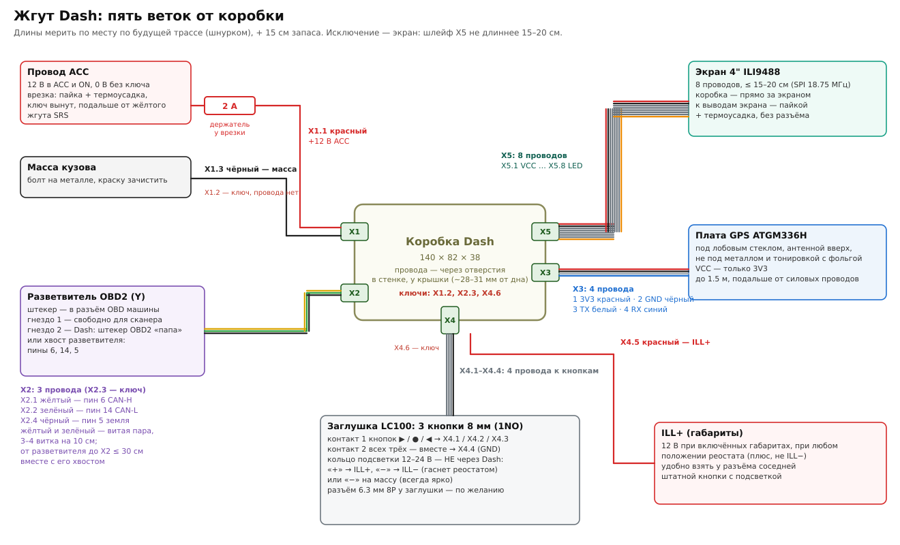

# Жгут: провода от коробки к машине, экрану, кнопкам и GPS

Пять веток, по клеммнику на каждую: **X1** питание, **X2** CAN, **X3** GPS, **X4** кнопки и габариты, **X5** экран. Что внутри коробки — [assembly.md](assembly.md). Общая схема — [wiring-overview.svg](wiring-overview.svg).

## Общие правила

- **Провод — 22 AWG** (силиконовый, в заказе). Цвета — как в таблицах ниже: по ним жгут читается без прозвонки.
- **Каждый провод подписан с обоих концов**: `X2.1`, `X5.8`…
  - Белая термоусадка + маркер, до усадки. Термоусадка 5.5 мм на 22 AWG болтается: усадить её на два провода сразу или подложить под неё полоску изоленты. Под бирки лучше 3 мм — она в списке покупок ([build-hardware.md](build-hardware.md) §8).
  - Или бирки из [carrier-template.pdf](carrier-template.pdf) (лист 3) под прозрачный скотч.
- **Длина** — мерить по будущей трассе шнурком или куском провода, вдоль штатных жгутов, и прибавить 15 см запаса. **Кроме экрана**: шлейф X5 не длиннее 15–20 см. Поэтому коробка ставится прямо за экраном, а далеко уходят только X1–X4.
- **Вилка клеммника** (KF2EDGK, винтовая):
  - зачистить 7–8 мм, жилы скрутить;
  - **не лудить**: олово под винтом со временем проседает, и контакт слабеет. Если есть втулочные наконечники — лучше с ними;
  - затянуть отвёрткой 2 мм с небольшим усилием, потом подёргать провод.
- **Прикрепить у вилки**: стяжкой к корпусу или к соседним проводам, чтобы тянуло не за винт.
- **Ключи** — X1.2, X2.3, X4.6. В этом месте вилки вставлен и зажат винтом штырь, провода туда нет. Поэтому вилки X1, X2, X4 не входят в чужие гнёзда ([carrier-board.md](carrier-board.md) §3, «Ключи»). Штырь не вынимать.
- **Ветки** — в гофру 7.5 мм (CAN, GPS, кнопки) или 11.6 мм (где идут вместе). Концы гофры и места выхода из неё — тканевой изолентой. Жгут крепить стяжками к штатным жгутам, не к подвижным частям и не к рулевой колонке.
- **Разъёмы в разрыве:** разъём 6.3 мм 8P с хвостами (в заказе) удобен у заглушки с кнопками (ветка X4), чтобы заглушку можно было вынуть. Deutsch DT без обжимных клещей не использовать.

## X1 — питание

| Провод | Цвет | Откуда | Куда |
|---|---|---|---|
| X1.1 | красный | врезка в провод ACC → держатель предохранителя 2 А | X1.1 |
| X1.2 | — | **ключ**, провода нет | — |
| X1.3 | чёрный | масса кузова (болт) | X1.3 |

**Найти провод ACC.** Мультиметр на «постоянное 20 В», чёрный щуп — на массу.

| Ключ | Провод ACC |
|---|---|
| вынут | 0 В |
| ACC | 12 В |
| ON | 12 В |
| START | обычно пропадает на время прокрутки: Dash перезапускается при каждом пуске — это нормально ([build-hardware.md](build-hardware.md) §5, шаг 6) |

Где искать: питание прикуривателя или розетки, разъём магнитолы. **Цвет провода сверить со схемой своего года** — по цвету наугад не врезаться.

**Врезка** — пайка в «окно», штатный провод не перерезать:
1. **Ключ вынут.** Место — подальше от жёлтого жгута и жёлтых разъёмов SRS (подушки безопасности): их не трогать и через них не мерить.
2. Снять 10–12 мм изоляции с провода ACC, не перерезая его: два кольцевых надреза и продольный между ними, или раздвинуть жилы шилом.
3. Намотать на голое место зачищенный конец нового провода и пропаять.
4. Изолировать двумя слоями изоленты внахлёст на целую изоляцию, поверх — тканевая изолента: она держит стык и не даёт ему тереться. Термоусадку на целый провод не надеть — поэтому здесь изолента; термоусадка — только на новом проводе и у держателя.
5. **Держатель предохранителя — сразу у врезки** (до 10 см), предохранитель 2 А. Хвосты держателя спаять с проводом 22 AWG под термоусадку.

**Масса:**
- Ближайший болт на металле кузова, зачистить краску под шайбой.
- Конец провода — кольцевая клемма (её ещё нет: в списке покупок, [build-hardware.md](build-hardware.md) §8), пайка + термоусадка. Петля из лужёного провода под шайбу — только на время: олово под болтом проседает.
- Пин 4/5 OBD для питания не брать.

**Проверка** (вилка X1 не вставлена в коробку):

| Ключ | Между X1.1 и X1.3 |
|---|---|
| ACC | 12 В |
| вынут | 0 В |

Между X1.1 и массой при вынутом предохранителе — обрыв, не КЗ.

## X2 — CAN

| Провод | Цвет | Откуда (разветвитель OBD2) | Куда |
|---|---|---|---|
| X2.1 | жёлтый | пин 6, CAN-H | X2.1 |
| X2.2 | зелёный | пин 14, CAN-L | X2.2 |
| X2.3 | — | **ключ**, провода нет | — |
| X2.4 | чёрный | пин 5, сигнальная земля | X2.4 |

- **Разветвитель (Y):** штекер — в разъём OBD машины, одно гнездо остаётся для сканера. Dash подключается ко второму гнезду. Номера пинов выбиты на разъёме.
  - **Есть хвост** — если гнездо 2 сидит на своём кабеле. Этот кабель можно отрезать у гнезда и найти в нём жилы пинов 6, 14, 5 прозвонкой от штекера. Штекер «папа» тогда не нужен.
  - **Нет хвоста** — разветвитель цельный, или оба гнезда в одном корпусе. Тогда нужен штекер OBD2 «папа» с тремя проводами на пинах 6, 14, 5. Его ещё нет: он в списке покупок ([build-hardware.md](build-hardware.md) §8).
- **Длина отвода:** от разветвителя до X2, вместе с хвостом самого разветвителя, — **не больше ~30 см**. Длинный отвод на 500 кбит/с даёт отражения ([vehicle-install.md](../vehicle-install.md)). Если так не выходит — записать, какая длина получается, и сообщить.
- **Жёлтый и зелёный — витая пара** по всей длине: зажать концы, скрутить 3–4 витка на 10 см. Подальше от форсунок и силовых проводов.
- **Проверка:** зажигание выключено, вилка X2 не в коробке. Между X2.1 и X2.2 ~60 Ом (две штатные оконечные шины). Если 0 — КЗ в проводах, если обрыв — не те пины.

## X3 — GPS

| Провод | Цвет | Откуда | Куда (плата GPS) |
|---|---|---|---|
| X3.1 | красный | X3.1 | VCC — **только 3V3** |
| X3.2 | чёрный | X3.2 | GND |
| X3.3 | белый | X3.3 | TX |
| X3.4 | синий | X3.4 | RX |

- **Где плата:**
  - под лобовым стеклом, антенной вверх, с видом на небо: на панели у стекла или за обшивкой стойки;
  - не под металлом;
  - если на стекле атермальная плёнка с металлом — сигнал хуже, проверить.
- **Провода:** до ~1.5 м, подальше от силовых. PPS не подключается. На плате в линиях TX и RX стоит по 100 Ом — от статики и наводок на этом проводе.
- **Пайка:** к выводам платы GPS, под термоусадку. Саму плату — на двусторонний скотч.
- **Проверка:** X3.1 звонится с VCC платы. После включения на DIAG появляется `GPS ?` → `V…` → спутники/скорость. Если `GPS -` — переставить провода X3.3 и X3.4.

## X4 — кнопки и габариты

| Провод | Цвет | Откуда | Куда |
|---|---|---|---|
| X4.1 | любой + метка ▶ | контакт 1 кнопки ▶ | X4.1 |
| X4.2 | любой + метка ● | контакт 1 кнопки ● | X4.2 |
| X4.3 | любой + метка ◀ | контакт 1 кнопки ◀ | X4.3 |
| X4.4 | чёрный | контакты 2 всех трёх кнопок, соединены вместе | X4.4 |
| X4.5 | красный + метка | ILL+ (габариты) | X4.5 |
| X4.6 | — | **ключ**, провода нет | — |

**Кнопки** — 8 мм, 1NO, без фиксации, в штатной заглушке LC100:
- три отверстия Ø8 в ряд, центры через 12 мм, средняя — по центру;
- за заглушкой нужно 15–20 мм;
- у каждой кнопки два контакта кнопки и два вывода подсветки — какие где, сверить мультиметром (прозвонка при нажатии).

**Подсветка кнопок — не через Dash.** Кольцо на 12–24 В:
- «+» — к ILL+;
- «−» — к ILL− штатной подсветки, тогда яркость гаснет реостатом вместе со штатными кнопками, или на массу, тогда всегда ярко.

Удобнее всего взять оба провода у разъёма соседней штатной кнопки с подсветкой.

**Найти ILL+:**

| Состояние | ILL+ | ILL− |
|---|---|---|
| габариты выключены | 0 В | — |
| габариты включены | 12 В при любом положении реостата | напряжение плавает вместе с ручкой |

Dash нужен именно ILL+: от него датчик на BC547 переключает день и ночь.

**Разъём:** у заглушки поставить разъём 6.3 мм 8P (в заказе), тогда заглушка снимается, не трогая жгут. Провода X4 (до пяти: X4.6 — ключ) + 2 провода подсветки — в 8 контактов помещаются.

**Проверка** (вилка X4 не в коробке):
- между X4.1 / X4.2 / X4.3 и X4.4 — обрыв, при нажатии своей кнопки — 0 Ом;
- X4.5: 12 В при включённых габаритах, 0 В без них.
- X4.1 / X4.2 / X4.3 относительно X4.4: **0 В** и при включённых габаритах. Напряжение здесь значит, что ILL+ или «+» кольца попал на провод кнопки; 12 В на этих контактах сожгут вход МК, последовательный 1 кОм на плате от постоянного напряжения не спасает.

## X5 — экран

| Провод | Цвет | Откуда | Куда (вывод экрана) |
|---|---|---|---|
| X5.1 | красный | X5.1 | VCC |
| X5.2 | чёрный | X5.2 | GND |
| X5.3 | любой + метка | X5.3 | CS |
| X5.4 | любой + метка | X5.4 | RESET |
| X5.5 | любой + метка | X5.5 | DC/RS |
| X5.6 | любой + метка | X5.6 | SDI (MOSI) |
| X5.7 | любой + метка | X5.7 | SCK |
| X5.8 | оранжевый или + метка | X5.8 | LED |

SDO (MISO) не подключается.

- **Не длиннее 15–20 см:** SPI на 18.75 МГц, на длинных проводах картинка сыпется (на DIAG растут `SPI` и `R`).
- **Пайка прямо к штырькам экрана,** под термоусадку. Dupont-разъёмы в машине от вибрации теряют контакт, поэтому от макетки и уходим.
- **Провода пучком,** GND рядом с SCK.
- **Проверка:** каждый X5.n звонится со своим выводом экрана, соседние между собой — нет.

## Перед первым включением в машине

1. **Без коробки:** по всем веткам — проверки выше. В X1 — 12 В только с ключом.
2. **Вилки по очереди, каждую — при вынутом ключе,** потом ключ и смотреть:
   - X1 → ACC: на маленьком экране `CAN --`;
   - X2 → ON: `ECM OK`;
   - затем X5 (главный экран), X4 (кнопки, габариты), X3 (GPS).
3. **Чек-лист прошивки и замеров:** [bench-first-flash.md](../bench-first-flash.md) §6.
4. **Прошивка в машине**, если понадобится: SWD на WeAct смотрит в стенку коробки — открыть крышку ([carrier-board.md](carrier-board.md) §4). Плата при этом питается от машины, поэтому от клона ST-LINK подключать только SWDIO, SWCLK и GND. Его 3.3 В не подключать: два источника 3V3 будут работать друг на друга.
